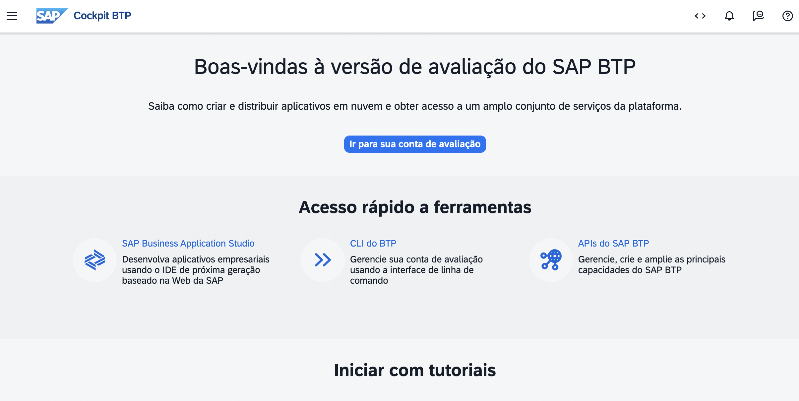
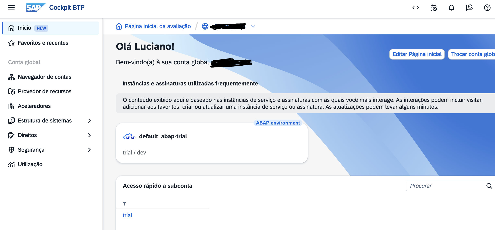
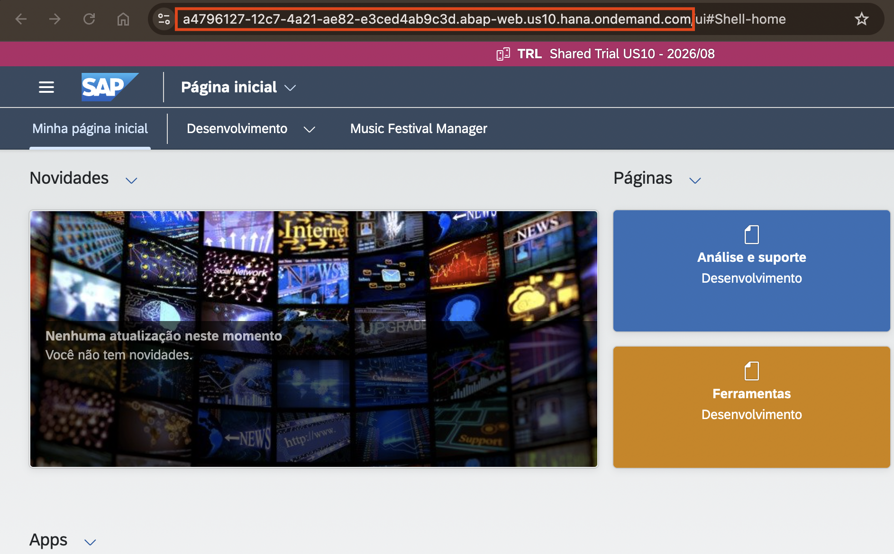

[Início - Hands On - SAP Inside Track Fortaleza 2026 - Crie Apps SAP Fiori utilizado IA Generativa](../../README.md)

# Primeiros Passos

## Introdução

Bem-vindo ao **Hands On do SAP Inside Track Fortaleza**! Antes de construir o seu app SAP Fiori, você precisa configurar o seu ambiente de desenvolvimento no **Visual Studio Code** e conectá-lo ao seu sistema ABAP.

Neste exercício, você vai instalar o Visual Studio Code, instalar a extensão ADT for Visual Studio Code e estabelecer uma conexão com o seu sistema ABAP.

### Exercícios

- [0.1 - Defina o seu ID do grupo](#exercício-01-defina-o-seu-id-do-grupo)
- [0.2 - Instalar o Visual Studio Code](#exercício-02-instalar-o-visual-studio-code)
- [0.3 - Instalar a Extensão ADT for Visual Studio Code](#exercício-03-instalar-a-extensão-adt-for-visual-studio-code)
- [0.4 - Conectar o Visual Studio Code ao Seu Sistema ABAP Cloud](#exercício-04-conectar-o-visual-studio-code-ao-seu-sistema-abap)
- [0.5 - Explorar a Interface do Visual Studio Code para Desenvolvimento ABAP](#exercício-05-explorar-a-interface-do-visual-studio-code-para-desenvolvimento-abap)
- [Resumo](#resumo)

> ℹ️ **Lembrete**: Você vai receber um **ID do grupo** na seção 0.1. Não se esqueça de substituir todas as ocorrências do placeholder **`###`** pelo seu ID do grupo em todos os exercícios.

---

## Exercício 0.1: Receba o seu ID do grupo
[^Topo da página](#)

> Neste exercício, você vai receber um ID do grupo que será usado ao longo de todo este workshop para identificar de forma única os artefatos do seu repositório e evitar conflitos com outros participantes que usam o mesmo sistema.

<details>
  <summary>🔵 Clique para expandir!</summary>

Como o ambiente ABAP é compartilhado por muitos participantes, todo artefato que você criar segue um padrão de nomenclatura com um sufixo pessoal.

Você encontrará o placeholder **`###`** em todos os nomes de objetos ao longo dos exercícios. Substitua-o pelo seu ID do grupo.

O ID do grupo pode conter **no máximo 3 caracteres (números e/ou letras)**, por exemplo `123`, `XY1` ou `ABC`. Esse mesmo será definido pelo instrutor durante o Hands On.

</details>

---

## Exercício 0.2: Instalar o Visual Studio Code
[^Topo da página](#)

> Faça o download e instale o Visual Studio Code no seu sistema, caso ainda não o tenha feito.

<details>
  <summary>🔵 Clique para expandir!</summary>

1. Abra um navegador e acesse [https://code.visualstudio.com/](https://code.visualstudio.com/).

2. Baixe o instalador para o seu sistema operacional (Windows, macOS ou Linux).

3. Execute o instalador e siga as instruções na tela.

4. Abra o **Visual Studio Code** assim que a instalação terminar.

   > ℹ️ **Dica**: Certifique-se de que você está usando uma versão estável recente do Visual Studio Code. Acesse **Help > About** para verificar a sua versão.

</details>

---

## Exercício 0.3: Instalar a Extensão ADT for Visual Studio Code
[^Topo da página](#)

> Instale a extensão **ABAP Development Tools (ADT)** para o Visual Studio Code a partir do Visual Studio Marketplace. Essa extensão conecta o Visual Studio Code ao seu backend ABAP e inclui o **ADT MCP Server** integrado, que você vai usar no Exercício 1.

<details>
  <summary>🔵 Clique para expandir!</summary>

### Passo 1: Instalar a partir do Visual Studio Code Marketplace

1. Abra o **Visual Studio Code**.

2. Abra a visão **Extensions**:
   - Pressione **`Ctrl+Shift+X`** (macOS: **`Cmd+Shift+X`**), ou
   - Clique no ícone **Extensions** na Activity Bar (borda esquerda)

3. Na barra de pesquisa, digite:
   ```
   ABAP Development Tools
   ```

4. Localize a extensão **"ABAP Development Tools"** publicada pela **SAP** e clique em **Install**.

5. Aguarde a conclusão da instalação.

   > ✅ **Sucesso**: Você deve ver "ABAP Development Tools" listada entre as extensões **Installed**.

   

### Passo 2: Verificar a instalação

1. Abra o **Command Palette** (**`Ctrl+Shift+P`**) e digite `ABAP`. Você deve ver comandos específicos de ABAP, como:
   - `ABAP: New Destination...`
   - `ABAP: Open Object...`
   - `ABAP: Create New ABAP Object...`
   - `ABAP: Activate`

   > ✅ Se você vir esses comandos, a extensão foi instalada corretamente.

   

</details>

---

## Exercício 0.4: Conectar o Visual Studio Code ao Seu Sistema ABAP
[^Topo da página](#)

> Crie uma **destination** no Visual Studio Code para conectar ao seu sistema ABAP e depois adicione-a ao seu workspace.
>
> Escolha o tipo de conexão que corresponde ao seu sistema:
> - **HTTP**: SAP BTP ABAP Environment ou SAP S/4HANA Cloud Public Edition
> - **RFC**: SAP S/4HANA on-premise ou SAP S/4HANA Cloud Private Edition (requer o SAP Logon configurado na sua máquina)

<details>
  <summary>🔵 Clique para expandir!</summary>

### Opção A: Destination HTTP (sistemas Cloud)

1. Para obter o link do ambiente ABAP Trial, você deverá entrar no site https://cockpit.hanatrial.ondemand.com/trial/#/home/trial e clicar em **"Ir para a sua conta de avaliação"**



2. Clicar em **"default_abap-trial"**



3. Pegar o endereço no browser da página que abriu até o .com. Ignorar o /ui#Shell-home. **Esse é o link do seu ambiente ABAP**.



4. Agora acesse o seu **VS Code** e abra o **Command Palette** (**`Ctrl+Shift+P`**).

5. Digite `ABAP: New Destination` e selecione **"ABAP: New Destination..."**.

6. Selecione **HTTP** como tipo de conexão.

7. Informe a **URL do sistema** ABAP Cloud. O formato da URL é:
   ```
   https://<system-id>.abap.<region>.hana.ondemand.com
   ```

8. Pressione **Enter** e depois informe um **ID** curto para esta destination (por exemplo, `BTP_DEV`).

9. Pressione **Enter**. A conexão é estabelecida.

   ```
   Command Palette → "ABAP: New Destination..."
     ↓
   Connection Type → HTTP
     ↓
   System URL → https://my-system.abap.eu10.hana.ondemand.com
     ↓
   Destination ID → BTP_DEV
     ↓
   ✅ Conexão estabelecida!
   ```

---

### Opção B: Destination RFC (sistemas on-premise)

> ℹ️ **Pré-requisito**: O seu sistema deve estar configurado no **SAP Logon** (SAP GUI) com conectividade RFC antes de prosseguir.

1. Abra o **Command Palette** (**`Ctrl+Shift+P`**).

2. Digite `ABAP: New Destination` e selecione **"ABAP: New Destination..."**.

3. Selecione **RFC** como tipo de conexão.

4. É exibida uma lista de sistemas da sua configuração do **SAP Logon**. Selecione o sistema de destino.

5. Informe o seu **usuário** (username) e pressione **Enter**.

6. Informe o **número do client** (por exemplo, `100`) e pressione **Enter**.

7. Informe o seu **idioma de logon** (por exemplo, `EN`) e pressione **Enter**.

8. A conexão é estabelecida.

   ```
   Command Palette → "ABAP: New Destination..."
     ↓
   Connection Type → RFC
     ↓
   System → S4D - Development System
     ↓
   Username → DEVELOPER01
     ↓
   Client → 100
     ↓
   Language → EN
     ↓
   ✅ Conexão estabelecida!
   ```

---

### Adicionar a destination ao seu workspace

> ⚠️ **Importante**: Este passo é necessário para ativar a extensão ADT e iniciar o MCP server local no Exercício 1.

1. Abra o **Command Palette** (**`Ctrl+Shift+P`**).

2. Digite `ABAP: Add Destination as Folder` e selecione **"ABAP: Add Destination as Folder to the Workspace..."**.

3. Selecione a destination que você acabou de criar.

4. Para sistemas **HTTP**: uma janela do navegador é aberta, então faça login com as credenciais do seu sistema ABAP.  
   Para sistemas **RFC**: a conexão é estabelecida imediatamente usando as suas credenciais do SAP Logon.

5. Após o login, a conexão com o seu sistema aparece como uma **pasta** na visão Explorer do Visual Studio Code (barra lateral esquerda).

</details>

---

## Exercício 0.5: Explorar a Interface do Visual Studio Code para Desenvolvimento ABAP
[^Topo da página](#)

> Familiarize-se com as principais áreas do Visual Studio Code que você vai usar ao longo deste workshop.

<details>
  <summary>🔵 Clique para expandir!</summary>

### Principais áreas da interface para desenvolvimento ABAP

| Área | Local | Finalidade |
|------|-------|------------|
| **Activity Bar** | Extrema esquerda | Alternar entre Explorer, Search, Source Control, Run & Debug e Extensions |
| **Explorer (Workspace)** | Barra lateral esquerda | Navegar pela hierarquia do seu sistema ABAP: pacotes, tipos de objeto e objetos |
| **Editor** | Centro | Editar o código-fonte ABAP (classes, CDS views, behavior definitions etc.) |
| **Chat do coding agent** (por exemplo, GitHub Copilot) | Barra lateral direita ou painel | Chat com IA: é aqui que você vai executar os prompts de MCP tools |
| **Problems Panel** | Parte inferior | Erros de sintaxe e avisos |
| **Terminal** | Parte inferior | Shell integrado |
| **Status Bar** | Extremo inferior | Linha/coluna atual, linguagem, sistema conectado |


### Atalhos de teclado essenciais

| Ação | Windows/Linux | macOS |
|------|---------------|-------|
| Command Palette | **`Ctrl+Shift+P`** | **`Cmd+Shift+P`** |
| Abrir objeto ABAP | **`Ctrl+Shift+A`** | **`Cmd+Shift+A`** |
| Criar objeto ABAP | **`Ctrl+Shift+Alt+N`** | **`Cmd+Shift+Option+N`** |
| Ativar objeto | **`Ctrl+F3`** | **`Cmd+F3`** |
| Ativar todos os inativos | **`Ctrl+Shift+F3`** | **`Cmd+Shift+F3`** |
| Salvar | **`Ctrl+S`** | **`Cmd+S`** |
| Localizar/Substituir | **`Ctrl+H`** | **`Cmd+H`** |
| Executar ABAP Unit Tests | **`Ctrl+Shift+F10`** | **`Cmd+Shift+F10`** |

> ℹ️ **Dica**: Use **Find/Replace** (**`Ctrl+H`**) para substituir de uma só vez todas as ocorrências de `###` pelo seu ID do grupo em qualquer arquivo.

### Navegando pelo seu sistema ABAP

1. Na visão **Explorer**, expanda a pasta da conexão com o seu sistema.

2. Navegue pela hierarquia de pacotes para encontrar objetos.

3. Use **`Ctrl+Shift+A`** para abrir rapidamente qualquer objeto pelo nome. Você pode usar wildcards, como `zrap130_*###`.

4. Objetos com alterações no backend ainda não salvas são marcados com **(L)** e precisam ser **ativados** (**`Ctrl+F3`**) para ficarem ativos no sistema.

</details>

---

## Resumo
[^Topo da página](#)

Você concluiu com sucesso:
- A definição do seu ID do grupo (`###`) para a nomenclatura dos artefatos
- A instalação do Visual Studio Code
- A instalação da extensão ADT for Visual Studio Code (que inclui o ADT MCP Server)
- A criação de uma destination HTTP e a conexão do Visual Studio Code ao seu sistema ABAP Cloud
- A adição da destination ao seu workspace e a autenticação
- A exploração das principais áreas do Visual Studio Code para desenvolvimento ABAP

Você pode continuar com o próximo exercício: **[Exercício 1: Habilitar o ADT MCP Server](../ex01/README.md)**

---
