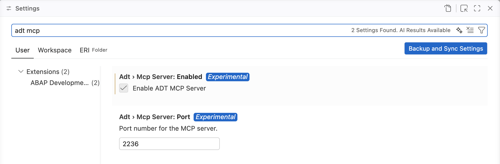
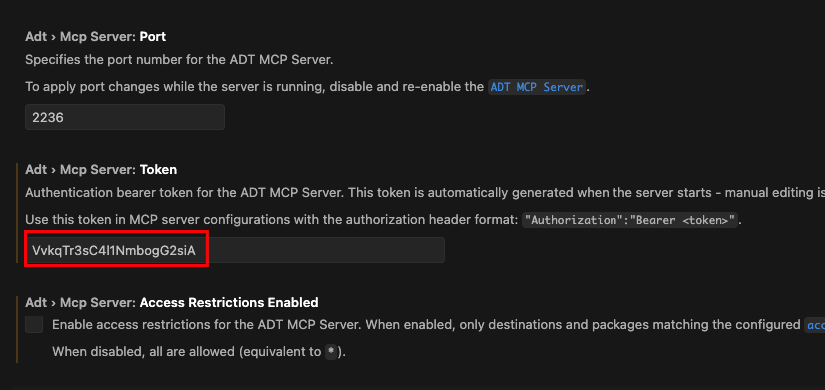
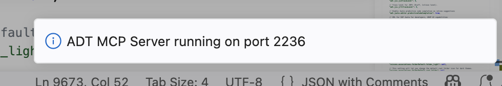
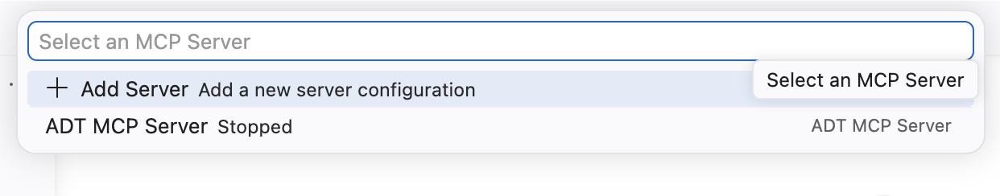
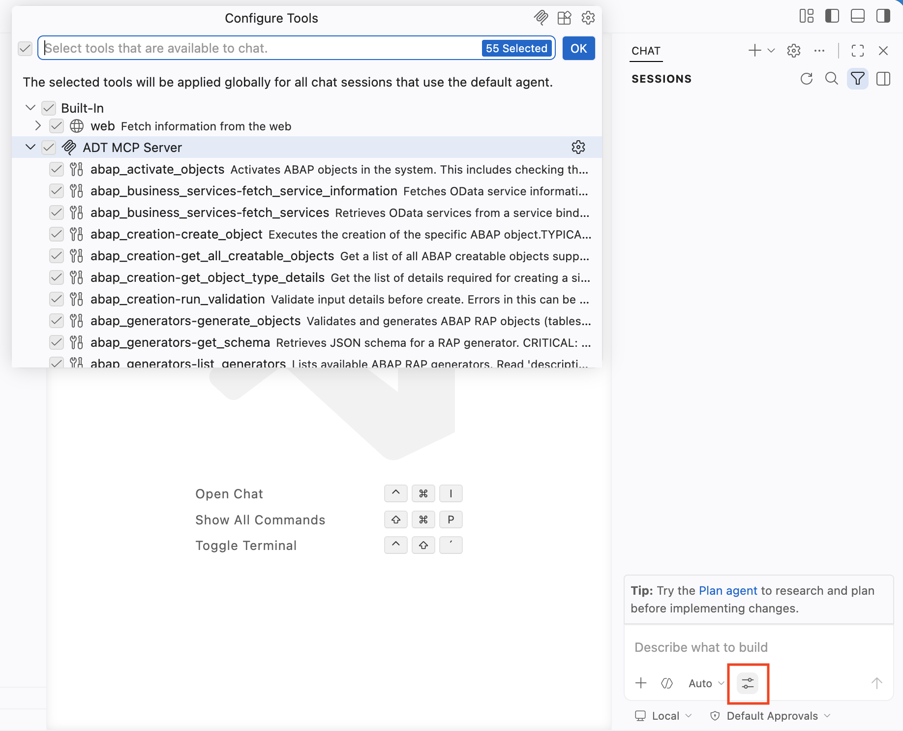
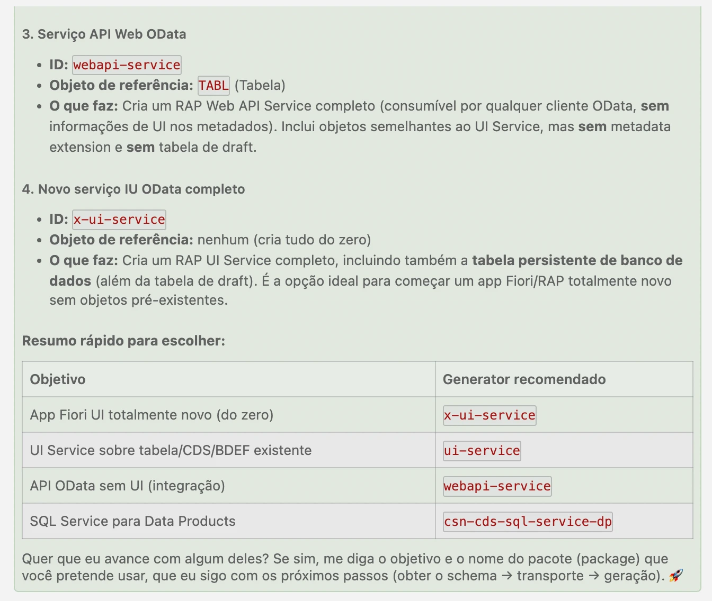

[Início - Hands On - SAP Inside Track Fortaleza 2026 - Crie Apps SAP Fiori utilizado IA Generativa](../../README.md)

# Exercício 1: Habilitar o ADT MCP Server 💎

## Introdução

No exercício anterior, você instalou o Visual Studio Code e a extensão ADT for Visual Studio Code, e se conectou ao seu sistema ABAP (_veja [Primeiros Passos](../ex0/README.md)_).

Neste exercício, você vai habilitar o **ADT MCP Server**, que é integrado à extensão ADT for Visual Studio Code, e verificar se as MCP tools estão disponíveis.

O ADT MCP Server expõe recursos de desenvolvimento ABAP como **Model Context Protocol (MCP) tools**, permitindo criar pacotes, criar transports, gerar aplicações RAP completas, ativar objetos e muito mais por meio de prompts em linguagem natural. Para mais informações, veja [Agentic AI for ABAP Development](https://help.sap.com/docs/abap-cloud/abap-development-tools-for-visual-studio-code/agentic-ai-development?locale=en-US)

### Exercícios

- [1.1 - Habilitar o ADT MCP Server nas Configurações do Visual Studio Code](#exercício-11-habilitar-o-adt-mcp-server-nas-configurações-do-visual-studio-code)
- [1.2 - Verificar se o MCP Server Está em Execução](#exercício-12-verificar-se-o-mcp-server-está-em-execução)
- [1.3 - Verificar as ADT MCP Tools no seu coding agent](#exercício-13-verificar-as-adt-mcp-tools-no-seu-coding-agent)
- [Resumo e Próximo Exercício](#resumo-e-próximo-exercício)

> ℹ️ **Lembrete**: Não se esqueça de substituir todas as ocorrências do placeholder **`###`** pelo seu ID do grupo nos passos do exercício abaixo.

---

## Sobre o ADT MCP Server 💎

O **ADT MCP Server** é um servidor HTTP local que roda dentro da extensão ADT for Visual Studio Code. Ele implementa o **Model Context Protocol (MCP)**, um padrão aberto que permite que assistentes de IA (como o GitHub Copilot) chamem tools de forma estruturada e autenticada.

Quando habilitado, o MCP server expõe um conjunto de ferramentas de desenvolvimento ABAP para qualquer cliente de IA compatível com MCP. Neste workshop, os exercícios usam o **GitHub Copilot** como cliente. Qualquer coding agent que suporte o virtual workspace filesystem do Visual Studio Code é compatível: o GitHub Copilot está confirmado, e outros também são suportados.

**Principais tools disponíveis via ADT MCP Server:**

| Tool | Descrição |
|------|-----------|
| `abap_activate-objects` | Ativa objetos ABAP no sistema backend |
| `abap_business_services-fetch_service_information` | Busca os metadados de um OData service |
| `abap_creation-create_object` | Cria objetos de desenvolvimento ABAP |
| `abap_generators-list_generators` | Lista os RAP generators ABAP disponíveis |
| `abap_generators-get_schema` | Recupera o JSON schema de um generator |
| `abap_generators-generate_objects` | **Executa um RAP generator**: a tool principal do Exercício 2 |
| `abap_run_unit_tests` | Executa ABAP unit tests para um conjunto de objetos |
| `abap_transport-create` | Cria uma transport request |
| `abap_transport-get` | Obtém as transport requests relevantes para um objeto |

Veja [ADT MCP Tools](https://help.sap.com/docs/abap-cloud/abap-development-tools-for-visual-studio-code/mcp-tools?locale=en-US) para a lista completa de tools disponíveis.

> ⚠ **Aviso sobre resultados gerados por IA** ⚠
> O ADT MCP Server é um **recurso experimental** que pode mudar a qualquer momento sem aviso prévio. Ele não se destina a uso produtivo. Faça backup dos seus dados antes de utilizá-lo.
>
> **Leitura adicional**: [Model Context Protocol (MCP)](https://modelcontextprotocol.io/)

---


## Exercício 1.1: Habilitar o ADT MCP Server nas Configurações do Visual Studio Code
[^Topo da página](#)

> Habilite o ADT MCP Server integrado nas configurações da extensão do Visual Studio Code.

<details>
  <summary>🔵 Clique para expandir!</summary>

1. Abra as **Configurações do Visual Studio Code**:
   - Abra o **Command Palette** com **`Ctrl+Shift+P`** (macOS: **`Cmd+Shift+P`**)
   - Digite `Preferences: Open Settings (UI)` e selecione **Preferences: Open Settings...**.

2. Na barra de pesquisa, digite:
   ```
   adt mcp
   ```

3. Localize a configuração **"Adt: Enable MCP Server"** (ou similar) e **habilite-a** marcando a caixa de seleção.

   > ℹ️ **Dica**: Você também pode alternar para o modo JSON (clique no ícone `{}` no canto superior direito das Settings) e adicionar:
   > ```json
   >  "adt.mcpServer.enabled": true
   > ```

4. Opcionalmente, você pode configurar a **porta do MCP server** (padrão: `2236`). Altere apenas se a porta 2236 estiver ocupada na sua máquina:
   - Pesquise por `ADT MCP port` nas Settings
   - Defina qualquer porta disponível entre `0` e `65535`

5. **Recarregue o Visual Studio Code** se for solicitado, ou feche e abra o aplicativo novamente.

   

6. Caso vá utilizar algum agente externo como Claude Code ou Codex por exemplo, obter o token gerado nessa mesma tela para utilização posterior.

   

> ⚠️ **Importante**: Certifique-se de que a destination do seu sistema ainda está adicionada ao workspace (do Exercício 0.4). O MCP server só inicia quando há uma destination ativa no workspace.

</details>

---

## Exercício 1.2: Verificar se o MCP Server Está em Execução
[^Topo da página](#)

> Confirme que o ADT MCP Server iniciou com sucesso.

<details>
  <summary>🔵 Clique para expandir!</summary>

Depois de habilitar a configuração e ter uma destination no workspace, o servidor deve iniciar automaticamente.

### Método 1: Verificar a notificação de inicialização

1. Observe o **canto inferior direito** do Visual Studio Code para ver uma notificação:
   ```
   ADT MCP Server running on port 2236
   ```

   

   > ℹ️ Se você não vir a notificação, siga para o Método 2.


### Método 2: Verificar pela lista de MCP Servers

1. Abra o **Command Palette** (**`Ctrl+Shift+P`**).

2. Digite:
   ```
   >MCP: List Servers
   ```

3. Selecione **"MCP: List Servers"** na lista.

4. Você deve ver uma entrada para o **ADT MCP Server** na lista de seleção rápida (quick pick).

5. Selecione-a e clique em **Start Server** caso ele ainda não esteja em execução.

   

### Solução de problemas

Se o ADT MCP Server não aparecer ou falhar ao iniciar:

1. **Desabilite e habilite novamente** a configuração "Adt: Enable MCP Server".
2. **Remova** a pasta da destination do workspace e **adicione-a novamente** (Command Palette → `ABAP: Add Destination as Folder to the Workspace...`).
3. **Reinicie** o Visual Studio Code.

</details>

---

## Exercício 1.3: Verificar/Inserir as ADT MCP Tools no seu coding agent
[^Topo da página](#)

> Abra o seu coding agent em agent mode e confirme que as ADT MCP tools estão carregadas e disponíveis.

<details>
  <summary>🔵 GitHub Copilot - Clique para expandir!</summary>

1. Abra o **GitHub Copilot Chat** no Visual Studio Code:
   - Clique no **ícone do Copilot** na Activity Bar (esquerda), ou
   - Pressione **`Ctrl+Shift+I`** (macOS: **`Cmd+Shift+I`**)

2. Mude o modo do chat para **"Agent"** no menu suspenso do chat.

   > ℹ️ **Nota**: As MCP tools só estão disponíveis no **Agent mode**, e não nos modos padrão Ask ou Edit.

3. Clique no botão **"Configure Tools"** (ícone de chave inglesa das tools) na barra de entrada do chat do Copilot.

4. Uma lista de seleção rápida (quick pick) aparece mostrando os provedores de tools disponíveis. Você deve ver:
   - **ADT MCP Server** com uma lista de tools abaixo dele (por exemplo, `abap_generators-list_generators`, `abap_creation-create_object` etc.)


   > ✅ Se você vir o ADT MCP Server e as suas tools listadas, a sua configuração está completa!

   

5. Certifique-se de que as tools do ADT MCP Server estão **marcadas/habilitadas** na lista.

6. **Teste rápido (sanity test)**: digite o prompt a seguir no chat do seu coding agent e pressione **Enter**:
   ```
   Liste todos os ABAP RAP generators disponíveis usando a MCP tool.
   ```

   O seu coding agent vai pedir permissão para chamar a tool `abap_generators-list_generators`. **Permita** a chamada da tool quando solicitado.

   Você deve ver uma lista de generators disponíveis, incluindo uma entrada chamada **"OData UI Service from Scratch"**.

   > ✅ Se você vir os nomes dos generators, o ADT MCP Server está funcionando corretamente com o seu coding agent!
   
   

</details>

<details>
  <summary>🔵 Claude Code - Clique para expandir!</summary>

1. Para inicar a configuração, você precisa do token gerado automáticamente no VS Code. Falamos desse ponto no item 6 do tópico 1.1 (_veja_ [Exercício 1.1: Habilitar o ADT MCP Server nas Configurações do Visual Studio Code](#exercício-11-habilitar-o-adt-mcp-server-nas-configurações-do-visual-studio-code)_)
1. Abra o **Claude Code** via terminal ou power shell:
   - Digite o comand **`Ctrl+Shift+I`** na Activity Bar (esquerda), ou
   - Pressione **`Ctrl+Shift+I`** (macOS: **`Cmd+Shift+I`**)

</details>

---

## Resumo e Próximo Exercício
[^Topo da página](#)

Agora que você:
- Habilitou o ADT MCP Server nas configurações da extensão do Visual Studio Code
- Verificou que o servidor está em execução (via notificação ou `MCP: List Servers`)
- Confirmou que as ADT MCP tools estão visíveis e podem ser chamadas pelo seu coding agent em agent mode

você pode continuar com o próximo exercício: **[Exercício 2: Gerar o App SAP Fiori via MCP Tools](../ex02/README.md)**

---
