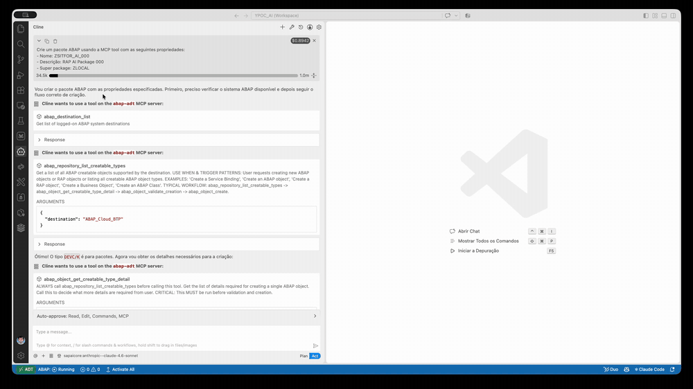
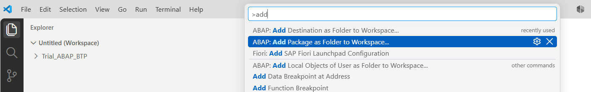
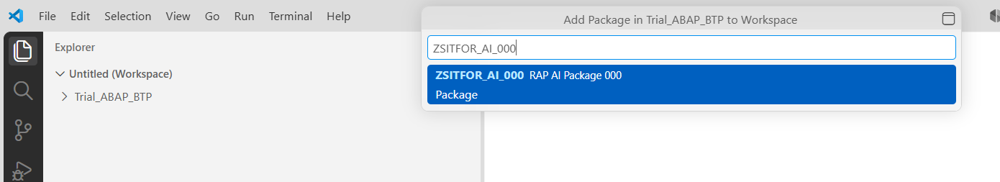
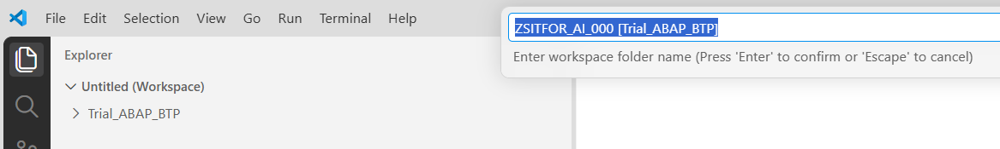
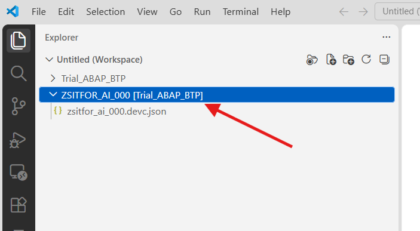
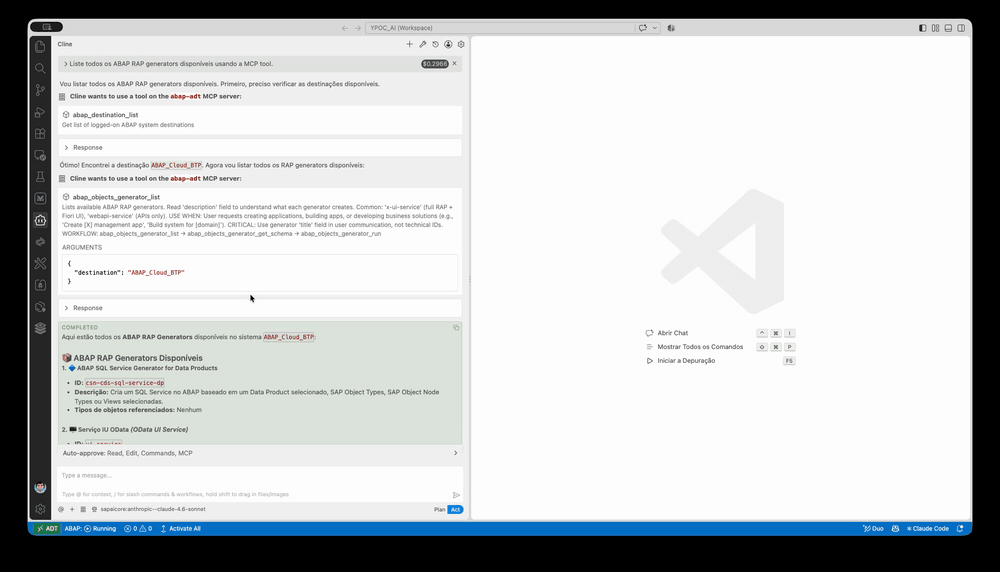
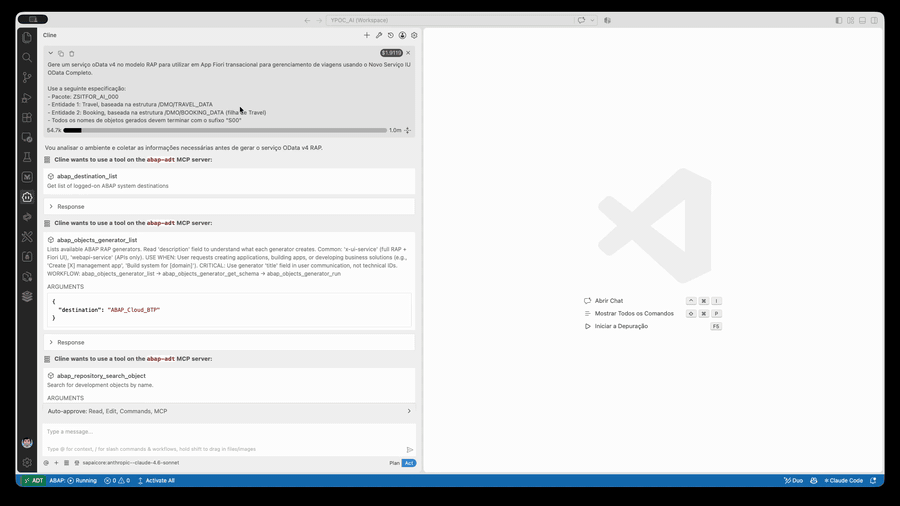
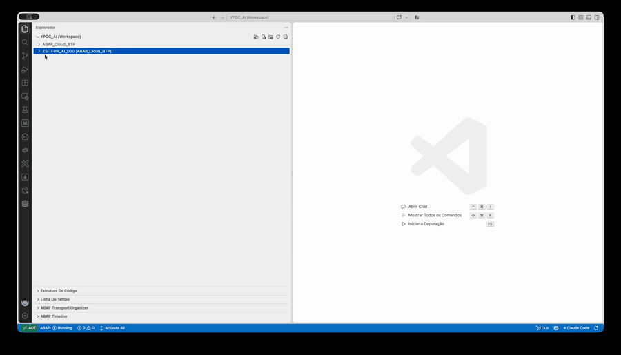

[Início - RAP130 - Crie Apps SAP Fiori com ABAP Cloud e SAP Joule for Developers no Visual Studio Code](../../README.md)

# Exercício 2: Gerar o App SAP Fiori via MCP Tools

## Introdução

No exercício anterior, você habilitou o ADT MCP Server e verificou que o seu coding agent consegue chamar as ADT MCP tools disponíveis (_veja o [Exercício 1](../ex01/README.md)_).

Neste exercício, você vai usar **o seu coding agent em agent mode** junto com as ADT MCP tools para:
1. Criar o seu pacote de desenvolvimento ABAP
2. Adicionar o pacote ao workspace do Visual Studio Code
3. Gerar um app SAP Fiori transacional completo (RAP business object Travel + Booking) usando o ABAP Cloud Generator, tudo conduzido por prompts em linguagem natural no chat do coding agent
4. Revisar e ativar os objetos gerados

### Exercícios

- [2.1 - Criar o Pacote ABAP](#exercício-21-criar-o-pacote-abap)
- [2.2 - Adicionar o pacote ao workspace](#exercício-22-adicionar-o-pacote-ao-workspace)
- [2.3 - Gerar o UI Service Transacional](#exercício-23-gerar-o-ui-service-transacional)
- [2.4 - Revisar e Ativar os Objetos Gerados](#exercício-24-revisar-e-ativar-os-objetos-gerados)
- [Resumo e Próximo Exercício](#resumo-e-próximo-exercício)

> ℹ️ **Lembrete**: Não se esqueça de substituir todas as ocorrências do placeholder **`###`** pelo seu ID do grupo nos passos do exercício abaixo.

---

## Sobre o ABAP Cloud Generator: App Transacional from Scratch

O **ABAP Cloud Generator: OData UI Service from Scratch** gera uma stack RAP completa a partir de uma descrição em linguagem natural do modelo de dados. Ele cria:

- Tabelas de banco de dados (uma por entidade)
- CDS base views (interface views)
- CDS projection views (consumption views)
- Metadata extensions (anotações de UI)
- Behavior definition 
- Classe de implementação do behavior
- Service definition
- Service binding

No [RAP120](https://github.com/SAP-samples/abap-platform-rap120) (Eclipse ADT), esse generator era acionado por meio de `Generate ABAP Repository Object > OData UI Service from Scratch`. No **RAP130**, o generator é exposto como uma MCP tool, chamada pelo seu coding agent a partir da janela de chat no Visual Studio Code.

> ⚠ **Aviso sobre resultados gerados por IA** ⚠
> Os nomes dos artefatos gerados, dos campos de banco de dados e de outros elementos podem diferir dos mostrados neste tutorial, pois são gerados por IA. **Sempre revise os artefatos gerados antes de continuar.**

---

## Exercício 2.1: Criar o Pacote ABAP
[^Topo da página](#)

> Crie o seu pacote do exercício **`ZSITFOR_AI_###`** pedindo ao seu coding agent, via ADT MCP tools.

> ℹ️ **Nota**: Os prints abaixo usam o ID do grupo **`000`** como exemplo. Substitua **`###`** pelo seu ID do grupo.

<details>
  <summary>🔵 Cline - Clique para expandir!</summary>

### Passo 1: Criar o pacote via MCP

1. No **Cline** (Act mode), copie e cole o prompt a seguir. Substitua **`###`** pelo seu ID do grupo:

   ```
   Crie um pacote ABAP usando a MCP tool com as seguintes propriedades:
   - Nome: ZSITFOR_AI_###
   - Descrição: RAP AI Package ###
   - Super package: ZLOCAL
   ```

   

</details>

<details>
  <summary>🔵 Claude Code - Clique para expandir!</summary>

### Passo 1: Criar o pacote via MCP

1. No **Claude Code**, copie e cole o prompt a seguir. Substitua **`###`** pelo seu ID do grupo:

   ```
   Crie um pacote ABAP usando a MCP tool com as seguintes propriedades:
   - Nome: ZSITFOR_AI_###
   - Descrição: RAP AI Package ###
   - Super package: ZLOCAL
   ```

</details>

---

## Exercício 2.2: Adicionar o pacote ao workspace
[^Topo da página](#)

> Adicione o pacote **`ZSITFOR_AI_###`** como uma pasta do workspace no **Visual Studio Code**.

> ℹ️ **Nota**: Os prints abaixo usam o ID do grupo **`000`** como exemplo. Substitua **`###`** pelo seu ID do grupo.

<details>
  <summary>🔵 Clique para expandir!</summary>

### Passo 1: Adicionar o pacote ao workspace

1. Abra o **Command Palette** com **`Ctrl+Shift+P`** (macOS: **`Cmd+Shift+P`**), digite `>add` e selecione **ABAP: Add Package as Folder to Workspace...**.

   

2. Digite o nome do seu pacote **`ZSITFOR_AI_###`** e selecione-o na lista.

   

3. Confirme o nome da pasta do workspace (sugerido como `ZSITFOR_AI_### [nome da sua destination]`) pressionando **Enter**.

   

4. O pacote passa a aparecer como uma pasta própria no **Explorer**, contendo o arquivo `zsitfor_ai_###.devc.json`. É nessa pasta que ficam os objetos gerados no Exercício 2.3.

   

</details>

---

## Exercício 2.3: Gerar o UI Service Transacional
[^Topo da página](#)

> Use as tools do ADT MCP para gerar um OData UI service transacional RAP completo para as entidades Travel e Booking.

> ⚠ **Aviso sobre resultados gerados por IA** ⚠
> Esteja ciente de que os resultados gerados por IA na descrição deste exercício podem diferir dos seus. **Sempre revise o código e os artefatos gerados.**

<details>
  <summary>🔵 Cline - Clique para expandir!</summary>

### Passo 1: Descobrir os generators disponíveis

1. No **Cline** (Plan mode), digite:

   ```
   Liste todos os ABAP RAP generators disponíveis usando a MCP tool.
   ```

   

### Passo 2: Executar a criação dos objetos

2. No **Cline** (Act mode), copie e cole o prompt a seguir. Substitua **`###`** pelo seu ID do grupo:

   ```
   Gere um serviço oData v4 no modelo RAP para utilizar em App Fiori transacional para gerenciamento de viagens usando o Novo Serviço IU OData Completo.

   Use a seguinte especificação:
   - Pacote: ZSITFOR_AI_###
   - Entidade 1: Travel, baseada na estrutura /DMO/TRAVEL_DATA
   - Entidade 2: Booking, baseada na estrutura /DMO/BOOKING_DATA (filha de Travel)
   - Todos os nomes de objetos gerados devem terminar com o sufixo "###"
   ```

   > ⚠️ **Atenção**: o campo de sufixo do generator aceita no **máximo 3 caracteres**. Por isso o ID do grupo (`###`) deve ter até 3 caracteres, como `001` ou `A12`.

   > ℹ️ **Nota**: O generator pode levar um momento para executar. O progresso será exibido.

3. O Cline vai chamar as MCP tools do generator para criar os objetos. **Permita cada chamada de tool** quando solicitado.

</details>

<details>
  <summary>🔵 Claude Code - Clique para expandir!</summary>

### Passo 1: Descobrir os generators disponíveis

1. No **Claude Code**, digite:

   ```
   Liste todos os ABAP RAP generators disponíveis usando a MCP tool.
   ```

### Passo 2: Executar a criação dos objetos

2. No **Claude Code**, copie e cole o prompt a seguir. Substitua **`###`** pelo seu ID do grupo:

   ```
   Gere um serviço oData v4 no modelo RAP para utilizar em App Fiori transacional para gerenciamento de viagens usando o Novo Serviço IU OData Completo.

   Use a seguinte especificação:
   - Pacote: ZSITFOR_AI_###
   - Entidade 1: Travel, baseada na estrutura /DMO/TRAVEL_DATA
   - Entidade 2: Booking, baseada na estrutura /DMO/BOOKING_DATA (filha de Travel)
   - Todos os nomes de objetos gerados devem terminar com o sufixo "###"
   ```

   > ⚠️ **Atenção**: o campo de sufixo do generator aceita no **máximo 3 caracteres**. Por isso o ID do grupo (`###`) deve ter até 3 caracteres, como `001` ou `A12`.

3. O Claude Code vai chamar as MCP tools do generator para criar os objetos. **Permita cada chamada de tool** quando solicitado.

   > ℹ️ **Nota**: O generator pode levar um momento para executar. O progresso será exibido.

</details>

---

## Exercício 2.4: Revisar e Ativar os Objetos Gerados
[^Topo da página](#)

> Revise os objetos gerados pelo generator no Exercício 2.3 e ative-os no **Visual Studio Code**.

<details>
  <summary>🔵 Clique para expandir!</summary>

### Passo 1: Revisar os objetos gerados

1. Quando o generator terminar, o seu coding agent vai informar a lista de objetos gerados. Você deve ver entradas para:
   - Tabelas de banco de dados: **`ZTRAVEL###`**, **`ZTRAVEL_D###`**, **`ZBOOKING###`** e **`ZBOOKING_D###`**
   - CDS base views: **`ZR_TRAVEL###`**, **`ZR_BOOKING###`**
   - CDS projection views: **`ZC_TRAVEL###`**, **`ZC_BOOKING###`**
   - Metadata extensions: **`ZC_TRAVEL###`** (DDLX), **`ZC_BOOKING###`** (DDLX)
   - Behavior definition: **`ZR_TRAVEL###`** (BDEF)
   - Classe de implementação do behavior: **`ZBP_R_TRAVEL###`**
   - Classe de projection behavior: **`ZBP_C_TRAVEL###`** 
   - Service definition: **`ZUI_TRAVEL_04###`** (SRVD)
   - Service binding: **`ZUI_TRAVEL_O4###`** (SRVB)

   > ℹ️ **Nota**: Os nomes exatos dos artefatos podem diferir um pouco, pois são gerados por IA e podem variar.

   

2. No **Explorer** do Visual Studio Code, pressione **F5** para atualizar o seu pacote **`ZSITFOR_AI_###`**. Você deve ver todos os objetos gerados listados nas respectivas pastas por tipo de objeto.

   

### Passo 2: Ativar todos os objetos gerados

    > ℹ️ **Dica**: Por padrão, a ferramenta já ativa todos os objetos. Porém, caso algum objeto não tenha sido ativado, você também pode pedir ao seu coding agent para ativar via MCP: digite `Ative todos os objetos do pacote ZSITFOR_AI_### usando a MCP tool` e permita a chamada da tool `abap_object_activate`.

</details>

---

## Resumo e Próximo Exercício
[^Topo da página](#)

Agora que você:
- Criou o pacote ABAP **`ZSITFOR_AI_###`** via ADT MCP tools
- Adicionou o pacote ao workspace do Visual Studio Code
- Gerou um UI service transacional RAP completo (Travel + Booking) via ADT MCP tools
- Ativou todos os objetos gerados

você pode continuar com o próximo exercício: **[Exercício 3: Publicar e Visualizar o App Travel](../ex03/README.md)**

---
