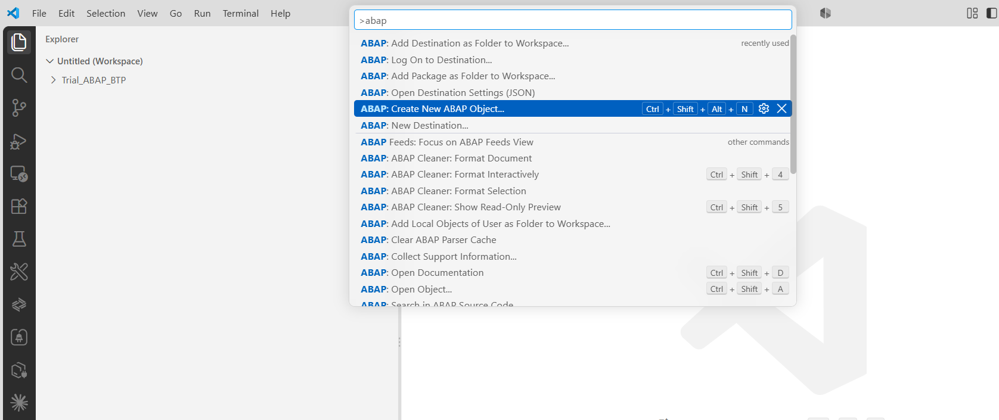
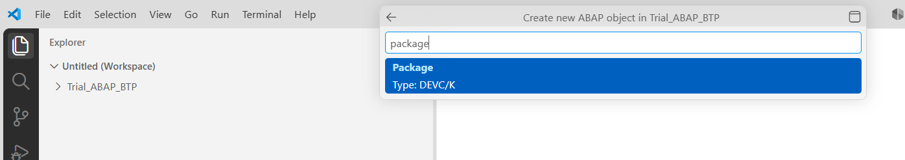
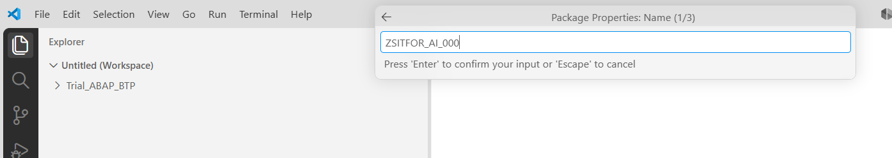
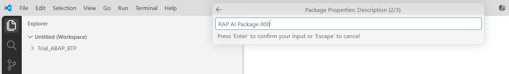
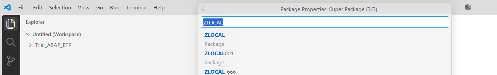
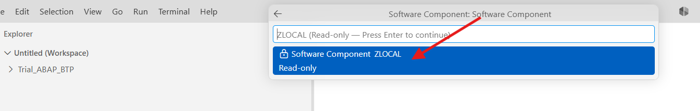
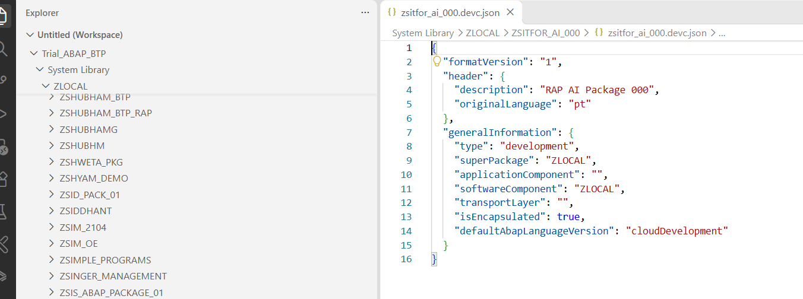

[Início - RAP130 - Crie Apps SAP Fiori com ABAP Cloud e SAP Joule for Developers no Visual Studio Code](../../README.md)

# Exercício 2: Gerar o App SAP Fiori via MCP Tools

## Introdução

No exercício anterior, você habilitou o ADT MCP Server e verificou que o seu coding agent consegue chamar as ADT MCP tools disponíveis (_veja o [Exercício 1](../ex01/README.md)_).

Neste exercício, você vai usar **o seu coding agent em agent mode** junto com as ADT MCP tools para:
1. Criar o seu pacote de desenvolvimento ABAP no Visual Studio Code
2. Gerar um app SAP Fiori transacional completo (RAP business object Travel + Booking) usando o ABAP Cloud Generator, tudo conduzido por prompts em linguagem natural no chat do coding agent

### Exercícios

- [2.1 - Criar o Pacote ABAP](#exercício-21-criar-o-pacote-abap)
- [2.2 - Gerar o UI Service Transacional](#exercício-22-gerar-o-ui-service-transacional)
- [Resumo e Próximo Exercício](#resumo-e-próximo-exercício)

> ℹ️ **Lembrete**: Não se esqueça de substituir todas as ocorrências do placeholder **`###`** pelo seu ID do grupo nos passos do exercício abaixo.

---

## Sobre o ABAP Cloud Generator: App Transacional from Scratch

O **ABAP Cloud Generator: OData UI Service from Scratch** gera uma stack RAP completa a partir de uma descrição em linguagem natural do modelo de dados. Ele cria:

- Tabelas de banco de dados (uma por entidade)
- CDS base views (interface views)
- CDS projection views (consumption views)
- Metadata extensions (anotações de UI)
- Behavior definition 
- Classe de implementação do behavior
- Service definition
- Service binding

No [RAP120](https://github.com/SAP-samples/abap-platform-rap120) (Eclipse ADT), esse generator era acionado por meio de `Generate ABAP Repository Object > OData UI Service from Scratch`. No **RAP130**, o generator é exposto como uma MCP tool, chamada pelo seu coding agent a partir da janela de chat no Visual Studio Code.

> ⚠ **Aviso sobre resultados gerados por IA** ⚠
> Os nomes dos artefatos gerados, dos campos de banco de dados e de outros elementos podem diferir dos mostrados neste tutorial, pois são gerados por IA. **Sempre revise os artefatos gerados antes de continuar.**

---

## Exercício 2.1: Criar o Pacote ABAP
[^Topo da página](#)

> Crie o seu pacote do exercício **`ZSITFOR_AI_###`** no **Visual Studio Code**. 

<details>
  <summary>🔵 Clique para expandir!</summary>

> ℹ️ **Nota**: Os prints abaixo usam o ID do grupo **`000`** como exemplo. Substitua **`###`** pelo seu ID do grupo.

### Passo 1: Criar o pacote

1. Abra o **Command Palette** com **`Ctrl+Shift+P`** (macOS: **`Cmd+Shift+P`**), digite `>abap` e selecione **ABAP: Create New ABAP Object...**.

   > 💡 **Dica**: Você também pode usar o atalho **`Ctrl+Shift+Alt+N`**.

   

2. Na lista de tipos de objeto, digite `package` e selecione **Package** (Type: `DEVC/K`).

   

3. Em **Package Properties: Name (1/3)**, informe o nome do pacote e pressione **Enter**:
   ```
   ZSITFOR_AI_###
   ```

   

4. Em **Package Properties: Description (2/3)**, informe a descrição e pressione **Enter**:
   ```
   RAP AI Package ###
   ```

   

5. Em **Package Properties: Super Package (3/3)**, informe **`ZLOCAL`** e pressione **Enter**.

   

6. Em **Software Component**, o valor **`ZLOCAL`** já vem preenchido (somente leitura). Pressione **Enter** para continuar.

   

7. O pacote é criado e o arquivo **`zsitfor_ai_###.devc.json`** é aberto no editor. No **Explorer**, o pacote aparece em **System Library → ZLOCAL → `ZSITFOR_AI_###`**.

   > ✅ Se você vir o arquivo `.devc.json` com `"superPackage": "ZLOCAL"`, o pacote foi criado com sucesso!

   

### Passo 2: Adicionar o pacote ao workspace

1. Abra o **Command Palette** com **`Ctrl+Shift+P`** (macOS: **`Cmd+Shift+P`**), digite `>add` e selecione **ABAP: Add Package as Folder to Workspace...**.

   

2. Digite o nome do seu pacote **`ZSITFOR_AI_###`** e selecione-o na lista.

   

3. Confirme o nome da pasta do workspace (sugerido como `ZSITFOR_AI_### [nome da sua destination]`) pressionando **Enter**.

   

4. O pacote passa a aparecer como uma pasta própria no **Explorer**, contendo o arquivo `zsitfor_ai_###.devc.json`. É nessa pasta que os objetos gerados no Exercício 2.2 vão aparecer.

   

</details>

---

## Exercício 2.2: Gerar o UI Service Transacional
[^Topo da página](#)

> Use as ADT MCP tools para gerar um OData UI service transacional RAP completo para as entidades Travel e Booking.

> ⚠ **Aviso sobre resultados gerados por IA** ⚠
> Esteja ciente de que os resultados gerados por IA na descrição deste exercício podem diferir dos seus. **Sempre revise o código e os artefatos gerados.**

<details>
  <summary>🔵 Clique para expandir!</summary>

### Passo 1: Descobrir os generators disponíveis

1. No **seu coding agent (Agent mode)**, digite:

   ```
   Liste todos os ABAP RAP generators disponíveis usando a MCP tool.
   ```

   

### Passo 2: Obter o schema do generator (opcional)

3. Para entender os parâmetros de entrada necessários, você pode perguntar ao seu coding agent:

   ```
   Obtenha o JSON schema do generator OData UI Service from Scratch.
   ```

4. Permita a chamada da tool `abap_generators-get_schema`. Revise o schema, que mostra quais campos o generator espera (nomes de entidades, listas de campos, sufixos etc.).

### Passo 3: Executar o generator

5. No **seu coding agent (Agent mode)**, copie e cole o prompt a seguir. Substitua **`###`** pelo seu ID do grupo:

   ```
   Gere um app SAP Fiori transacional para gerenciamento de viagens usando o ABAP RAP generator.

   Use a seguinte especificação:
   - Pacote: ZSITFOR_AI_###
   - Entidade 1: Travel, baseada na estrutura /DMO/TRAVEL_DATA
   - Entidade 2: Booking, baseada na estrutura /DMO/BOOKING_DATA (filha de Travel)
   - Todos os nomes de objetos gerados devem terminar com o sufixo "###"
   ```

6. O seu coding agent vai planejar a geração. Provavelmente ele vai chamar:
   - `abap_generators-get_schema`: para recuperar o schema de entrada do generator
   - `abap_generators-generate_objects`: para executar a geração

   **Permita cada chamada de tool** quando solicitado.

   > ℹ️ **Nota**: O generator pode levar um momento para executar. O progresso será exibido.

   

### Passo 4: Revisar os objetos gerados

7. Quando o generator terminar, o seu coding agent vai informar a lista de objetos gerados. Você deve ver entradas para:
   - Tabelas de banco de dados: **`ZTRAVEL###`**, **`ZTRAVEL_D###`**, **`ZBOOKING###`** e **`ZBOOKING_D###`**
   - CDS base views: **`ZR_TRAVEL###`**, **`ZR_BOOKING###`**
   - CDS projection views: **`ZC_TRAVEL###`**, **`ZC_BOOKING###`**
   - Metadata extensions: **`ZC_TRAVEL###`** (DDLX), **`ZC_BOOKING###`** (DDLX)
   - Behavior definition: **`ZR_TRAVEL###`** (BDEF)
   - Classe de implementação do behavior: **`ZBP_R_TRAVEL###`**
   - Classe de projection behavior: **`ZBP_C_TRAVEL###`** 
   - Service definition: **`ZUI_TRAVEL_04###`** (SRVD)
   - Service binding: **`ZUI_TRAVEL_O4###`** (SRVB)

   > ℹ️ **Nota**: Os nomes exatos dos artefatos podem diferir um pouco, pois são gerados por IA e podem variar.

   

8. No **Explorer** do Visual Studio Code, pressione **F5** para atualizar o seu pacote **`ZSITFOR_AI_###`**. Você deve ver todos os objetos gerados listados nas respectivas pastas por tipo de objeto.

   

### Passo 5: Ativar todos os objetos gerados

9. Ative todos os objetos inativos de uma só vez usando o atalho de teclado:
   - **`Ctrl+Shift+F3`** (macOS: **`Cmd+Shift+F3`**)

   Ou pela opção `Activate All` na barra de ferramentas inferior

   


10. Uma caixa de diálogo mostra todos os objetos inativos. Selecione todos e clique em **Activate**.

    > ⚠️ Se algum objeto falhar na ativação, verifique o painel **Problems** (**`Ctrl+Shift+M`**) para ver os detalhes do erro. Corrija os problemas e ative novamente.

    > ℹ️ **Dica**: Você também pode pedir ao seu coding agent para ativar via MCP: digite `Ative todos os objetos do pacote ZSITFOR_AI_### usando a MCP tool` e permita a chamada da tool `abap_activate-objects`.

</details>

---

## Resumo e Próximo Exercício
[^Topo da página](#)

Agora que você:
- Criou o pacote ABAP **`ZSITFOR_AI_###`** no Visual Studio Code e o adicionou ao workspace
- Gerou um UI service transacional RAP completo (Travel + Booking) via ADT MCP tools
- Ativou todos os objetos gerados

você pode continuar com o próximo exercício: **[Exercício 3: Publicar e Visualizar o App Travel](../ex03/README.md)**

---
