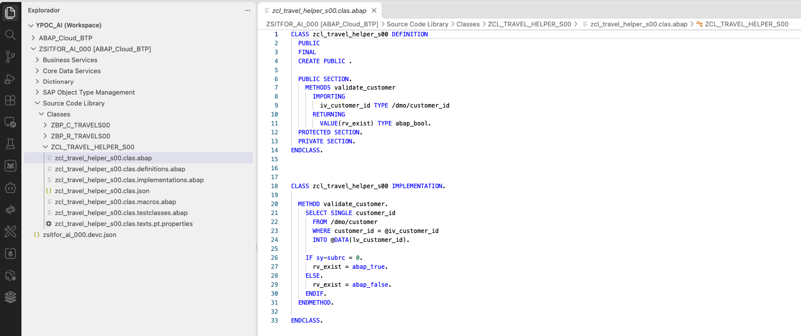

[Início - RAP130 - Crie Apps SAP Fiori com ABAP Cloud e SAP Joule for Developers no Visual Studio Code](../../README.md)

# Exercício 3: Publicar e Visualizar o App Travel

## Introdução

No exercício anterior, você gerou um UI service RAP transacional completo para Travel e Booking usando o seu coding agent e as ADT MCP tools (_veja o [Exercício 2](../ex02/README.md)_).

Neste exercício, você vai publicar o endpoint local de serviço do seu service binding OData V4 e abrir o **SAP Fiori elements App Preview** em um navegador para ver o app Travel em funcionamento.

### Exercícios

- [3.1 - Publicar o Service Binding](#exercício-31-publicar-o-service-binding)
- [3.2 - Visualizar o App Travel no Navegador](#exercício-32-visualizar-o-app-travel-no-navegador)
- [3.3 - Criar a classe ABAP auxiliar](#exercício-33-criar-a-classe-abap-auxiliar)
- [Resumo e Próximo Exercício](#resumo-e-próximo-exercício)

> ℹ️ **Lembrete**: Não se esqueça de substituir todas as ocorrências do placeholder **`###`** pelo seu ID do grupo nos passos do exercício abaixo.

---

## Exercício 3.1: Publicar o Service Binding
[^Topo da página](#)

> ℹ️ **Nota**: Por padrão, a ferramenta já publica o serviço automáticamente. Caso não tenha ativado, seguir os passos abaixo para ativar.

> Publique o endpoint local de serviço do service binding **`ZUI_TRAVEL_O4###`** para tornar o OData service disponível para preview e consumo.

<details>
  <summary>🔵 Clique para expandir!</summary>

1. Abra o service binding usando **`Ctrl+Shift+A`** e pesquise por **`ZUI_TRAVEL_O4###`**. Selecione a entrada do tipo **Service Binding** (SRVB).

2. Clique no botão **Publish** na barra de ferramentas do editor (área superior do editor do service binding).

   > ℹ️ A ação "Publish" registra um endpoint local de serviço que permite que o preview do Fiori elements e consumidores externos descubram o serviço.

   

4. Aguarde a conclusão da publicação. 

   > ✅ Você deve ver na parte inferior a mensagem _Publish/unpublish action in progress_.

</details>

---

## Exercício 3.2: Visualizar o App Travel no Navegador
[^Topo da página](#)

> Abra o SAP Fiori elements App Preview para a entidade Travel.

<details>
  <summary>🔵 Clique para expandir!</summary>

1. Abra o seu service binding **`ZUI_TRAVEL_O4###`** e clique no botão **Preview**.

   

2. Selecione a entidade `Travel` e clique em **Open** na caixa de diálogo.
   
   

   Uma janela do navegador é aberta com o **SAP Fiori elements App Preview** da sua aplicação Travel.

2. Tente criar uma nova entidade `Travel`:
   - Clique em **Create** e preencha alguns campos: **Destination**, **Begin Date**, **End Date**
   - Preencha **Agency ID** e **Customer ID** (use quaisquer IDs válidos dos dados de referência de voo DMO, por exemplo `070001` para Agency e `000001` para Customer)
   - Clique em **Save**

   > ✅ Se você conseguir criar e salvar um registro de Travel, o app está funcionando corretamente!

</details>

---

## Exercício 3.3: Criar a classe ABAP auxiliar
[^Topo da página](#)

> Crie uma classe auxiliar (helper class) para validação de dados. Ela será utilizada nos próximos exercícios.

<details>
  <summary>🔵 Cline - Clique para expandir!</summary>

Carregar dados de demonstração torna o app mais interessante de usar nos demais exercícios.

1. No **Cline** (Act mode), copie e cole o prompt a seguir. Substitua **`###`** pelo seu ID do grupo:

   ```
   Criar uma classe ABAP com os seguintes parâmetros:

   Package: ZSITFOR_AI_###
   Name: ZCL_TRAVEL_HELPER_###
   Description: Travel helper class ###

   A classe terá dois métodos:

   Método público validate_customer com um parâmetro de import com o nome iv_customer_id TYPE /dmo/customer_id e um parâmetro de retorno com o nome rv_exist do tipo abap_bool.

   Dentro do método validate_customer, deverá fazer um select single na tabela /dmo/customer onde o campo customer_id = parâmetro iv_customer_id. Caso tenha algum registro, deverá ser inserido no parâmetro de retorno rv_exist um abap_true. Caso contrário, abap_false.
   ```

   Ao final, a classe **`ZCL_TRAVEL_HELPER_###`** aparece no **Explorer** do Visual Studio Code, em **Source Code Library → Classes**.

   

2. Confirme que a classe está ativa. Se necessário, abra-a e ative com **`Ctrl+F3`**.

</details>

<details>
  <summary>🔵 Claude Code - Clique para expandir!</summary>

1. No **Claude Code**, copie e cole o prompt a seguir. Substitua **`###`** pelo seu ID do grupo:

   ```
   Criar uma classe ABAP com os seguintes parâmetros:

   Package: ZSITFOR_AI_###
   Name: ZCL_TRAVEL_HELPER_###
   Description: Travel helper class ###

   A classe terá dois métodos:

   Método público validate_customer com um parâmetro de import com o nome iv_customer_id TYPE /dmo/customer_id e um parâmetro de retorno com o nome rv_exist do tipo abap_bool.

   Dentro do método validate_customer, deverá fazer um select single na tabela /dmo/customer onde o campo customer_id = parâmetro iv_customer_id. Caso tenha algum registro, deverá ser inserido no parâmetro de retorno rv_exist um abap_true. Caso contrário, abap_false.
   ```

2. Confirme que a classe está ativa. Se necessário, abra-a e ative com **`Ctrl+F3`**.

</details>

---

## Resumo e Próximo Exercício
[^Topo da página](#)

Agora que você:
- Publicou o endpoint local de serviço do service binding **`ZUI_TRAVEL_O4###`**
- Abriu e testou o SAP Fiori elements App Preview no navegador
- Criou um registro de viagem de teste para verificar que o app está funcionando
- Criou uma helper class para uso futuro

Você pode continuar com o próximo exercício: **[Exercício 4: Adicionar uma Validação](../ex04/README.md)**

---
