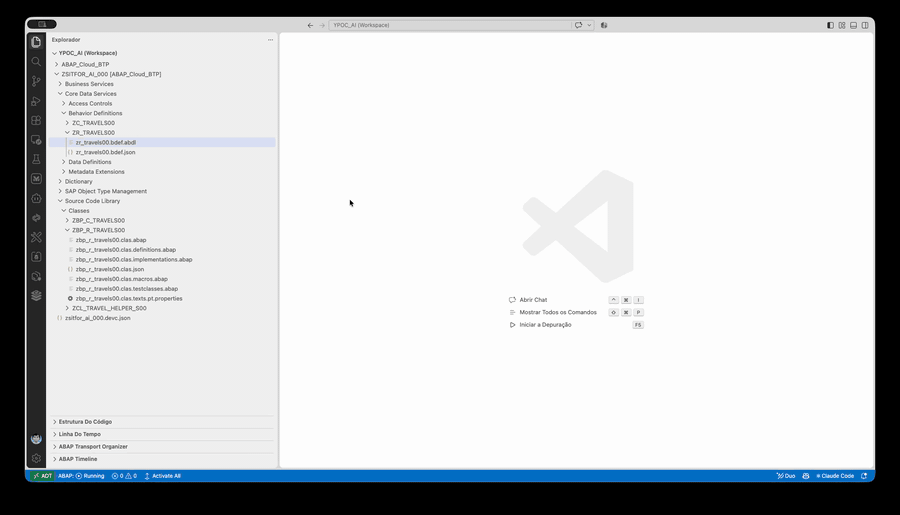
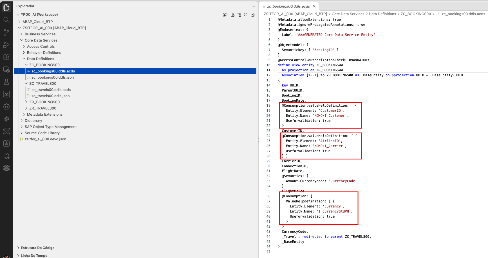
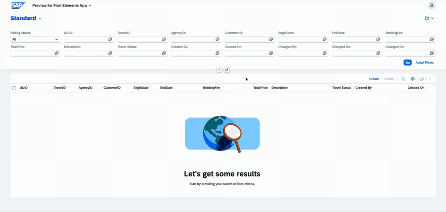

[Início - RAP130 - Crie Apps SAP Fiori com ABAP Cloud e SAP Joule for Developers no Visual Studio Code](../../README.md)

# Exercício 4: Adicionar uma Validação

## Introdução

No exercício anterior, você gerou o app SAP Fiori usando o ADT MCP Server (_veja o [Exercício 3](../ex03/README.md)_).

Neste exercício, você vai usar **o seu coding agent em Agent mode** para definir e implementar uma **validação** de backend chamada **`validateCustomer`** em um único passo: tanto a declaração na behavior definition quanto a implementação no behavior pool serão feitas pelo seu coding agent.

### Exercícios

- [4.1 - Definir e Implementar a Validação](#exercício-41-definir-e-implementar-a-validação)
- [4.2 - Visualizar e Testar o App Travel Aprimorado](#exercício-42-visualizar-e-testar-o-app-travel-aprimorado)
- [4.3 - Adicionar ajuda de pesquisa para campos de cliente, agencia e operador](#exercício-43-adicionar-ajuda-de-pesquisa-para-campos-de-cliente-agencia-e-operador)
- [Resumo e Próximo Exercício](#resumo-e-próximo-exercício)

> ℹ️ **Lembrete**: Não se esqueça de substituir todas as ocorrências do placeholder **`###`** pelo seu ID do grupo nos passos do exercício abaixo.

---

## Exercício 4.1: Definir e Implementar a Validação
[^Topo da página](#)

> Use o seu coding agent para declarar `validateCustomer` na behavior definition **`ZR_TRAVEL###`** e implementá-la em **`ZBP_R_TRAVEL###`** de uma só vez.

> ⚠ **Aviso sobre resultados gerados por IA** ⚠
> Esteja ciente de que os resultados gerados por IA na descrição deste exercício podem diferir dos seus. **Sempre revise o código gerado antes de ativar.**

<details>
  <summary>🔵 Cline - Clique para expandir!</summary>

1. No **Cline** (Act mode), copie e cole o prompt a seguir:

   ```
   Adicione a validação validateCustomer. Na sua implementação, deve ser usado o método validate_customer da classe ABAP ZCL_TRAVEL_HELPER_###. Peça para revisar as alterações antes de prosseguir com a ativação
   ```

   > ℹ️ Substitua `###` pelo seu ID do grupo no prompt antes de enviá-lo.

   O Cline vai alterar tanto a behavior definition quanto a classe de implementação **`ZBP_R_TRAVEL###`**. **Revise as alterações com atenção** antes de confirmar a ativação.

   

</details>

<details>
  <summary>🔵 Claude Code - Clique para expandir!</summary>

1. No **Claude Code**, copie e cole o prompt a seguir:

   ```
   Adicione a validação validateCustomer. Na sua implementação, deve ser usado o método validate_customer da classe ABAP ZCL_TRAVEL_HELPER_###. Peça para revisar as alterações antes de prosseguir com a ativação
   ```

   > ℹ️ Substitua `###` pelo seu ID do grupo no prompt antes de enviá-lo.

   O Claude Code vai alterar tanto a behavior definition quanto a classe de implementação **`ZBP_R_TRAVEL###`**. **Revise as alterações com atenção** antes de confirmar a ativação.

</details>

---

## Exercício 4.2: Visualizar e Testar o App Travel Aprimorado
[^Topo da página](#)

> Teste a validação `validateCustomer` no Fiori elements App Preview.

<details>
  <summary>🔵 Clique para expandir!</summary>

1. Abra o service binding **`ZUI_TRAVEL_O4###`** (use **`Ctrl+Shift+A`** para encontrá-lo), selecione a entidade **Travel** e clique em **Preview**.

2. No app, clique em **Create** para iniciar um novo registro de viagem.

3. No campo **Customer ID**, informe um **ID de cliente inválido**, por exemplo `999999`.

4. Clique em **Save**.

   > ✅ O app deve exibir uma mensagem de erro de validação: **"Customer 999999 does not exist"** (ou similar). O salvamento é rejeitado.

   

6. Agora corrija o **Customer ID** para um válido (por exemplo, `000001`) e clique em **Save** novamente.

   > ✅ O registro de viagem é salvo com sucesso.

</details>

---

## Exercício 4.3: Adicionar ajuda de pesquisa para campos de cliente, agencia e operador
[^Topo da página](#)

> Use o seu coding agent para adicionar ajuda de pesquisa (value help) aos campos de cliente, agência e operador (companhia aérea) do app Travel.

> ⚠ **Aviso sobre resultados gerados por IA** ⚠
> Esteja ciente de que os resultados gerados por IA na descrição deste exercício podem diferir dos seus. **Sempre revise o código gerado antes de ativar.**

<details>
  <summary>🔵 Cline - Clique para expandir!</summary>

1. No **Cline** (Act mode), copie e cole o prompt a seguir:

   ```
   Adicionar ajuda de pesquisa nos campos de cliente, agencia e operador no projeto do pacote ZSITFOR_AI_###. Para o campo de cliente, utilizar a CDS /DMO/I_Customer como base. Para o campo de agencia, utilizar a CDS /DMO/I_Agency como base. Para o campo de operador, utilizar a CDS /DMO/I_Carrier como base.
   ```

   > ℹ️ Substitua `###` pelo seu ID do grupo no prompt antes de enviá-lo.

   O Cline vai alterar as CDS projection views, adicionando a anotação `@Consumption.valueHelpDefinition` nos campos de cliente, agência e operador (companhia aérea). **Revise as alterações com atenção** antes de confirmar a ativação.

   

2. Atualize o **Fiori elements App Preview** e abra a ajuda de pesquisa de um dos campos, por exemplo o **Customer ID**.

   

</details>

<details>
  <summary>🔵 Claude Code - Clique para expandir!</summary>

1. No **Claude Code**, copie e cole o prompt a seguir:

   ```
   Adicionar ajuda de pesquisa nos campos de cliente, agencia e operador no projeto do pacote ZSITFOR_AI_###. Para o campo de cliente, utilizar a CDS /DMO/I_Customer como base. Para o campo de agencia, utilizar a CDS /DMO/I_Agency como base. Para o campo de operador, utilizar a CDS /DMO/I_Carrier como base.
   ```

   > ℹ️ Substitua `###` pelo seu ID do grupo no prompt antes de enviá-lo.

   O Claude Code vai alterar as CDS projection views, adicionando a anotação `@Consumption.valueHelpDefinition` nos campos de cliente, agência e operador (companhia aérea). **Revise as alterações com atenção** antes de confirmar a ativação.

2. Atualize o **Fiori elements App Preview** e abra a ajuda de pesquisa de um dos campos, por exemplo o **Customer ID**.

</details>

---

## Resumo e Próximo Exercício
[^Topo da página](#)

Agora que você:
- Usou o seu coding agent em Agent mode para definir e implementar a validação `validateCustomer` em um único passo
- Testou a validação no Fiori elements App Preview, confirmando que IDs de cliente inválidos são rejeitados
- Adicionou ajuda de pesquisa aos campos de cliente, agência e operador

você pode continuar com o próximo exercício: **[Exercício 5: Gerar o App SAP Fiori via Fiori MCP](../ex05/README.md)**

---
