[Início - RAP130 - Crie Apps SAP Fiori com ABAP Cloud e SAP Joule for Developers no Visual Studio Code](../../README.md)

# Exercício 5: Gerar o App SAP Fiori via Fiori MCP

## Introdução

Nos exercícios anteriores, você criou toda a parte de backend (serviço OData V4 no modelo RAP) com validação e ajudas de pesquisa (_veja o [Exercício 4](../ex04/README.md)_).

Neste exercício, você vai usar **o seu coding agent** junto com o **Fiori MCP Server** (_veja o [Exercício 1 - Parte B](../ex01/README.md#parte-b-fiori-mcp-server)_) para gerar o app SAP Fiori elements que consome o serviço OData.

### Exercícios

- [5.1 - Criar a pasta do projeto e abri-la em uma nova janela](#exercício-51-criar-a-pasta-do-projeto-e-abri-la-em-uma-nova-janela)
- [5.2 - Adicionar o sistema SAP](#exercício-52-adicionar-o-sistema-sap)
- [5.3 - Testar o Fiori MCP Server](#exercício-53-testar-o-fiori-mcp-server)
- [5.4 - Obter o link do serviço OData](#exercício-54-obter-o-link-do-serviço-odata)
- [5.5 - Criar o App Fiori](#exercício-55-criar-o-app-fiori)
- [5.6 - Visualizar o App Fiori](#exercício-56-visualizar-o-app-fiori)
- [Resumo e Próximo Exercício](#resumo-e-próximo-exercício)

---

## Exercício 5.1: Criar a pasta do projeto e abri-la em uma nova janela
[^Topo da página](#)

> Crie uma pasta no seu computador para os arquivos do projeto Fiori e abra-a em uma **nova janela** do **Visual Studio Code**.

> ℹ️ **Nota**: A pasta é aberta em uma nova janela porque o app Fiori é **outro desenvolvimento**, separado do pacote ABAP **`ZSITFOR_AI_###`** do workspace atual.

<details>
  <summary>🔵 Clique para expandir!</summary>

### Passo 1: Criar a pasta do projeto

1. No seu computador (Windows ou macOS), crie uma pasta nova e vazia para os arquivos do projeto Fiori, por exemplo `fiori-travel-###`.

   > ℹ️ **Dica**: Prefira um caminho curto e sem espaços ou acentos, por exemplo `C:\projetos\fiori-travel-###` (Windows) ou `~/projetos/fiori-travel-###` (macOS).

### Passo 2: Abrir a pasta em uma nova janela

2. No Visual Studio Code, abra o menu **Arquivo** (_File_) e selecione **Abrir Pasta...** (_Open Folder..._).

   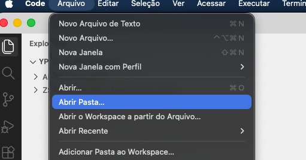

3. A janela **Abrir a Pasta** mostra, por padrão, o repositório ABAP (`/repotree-v1/ABAP_Cloud_BTP/...`). Clique em **Mostrar Local** (_Show Local_) para navegar pelas pastas do seu computador.

   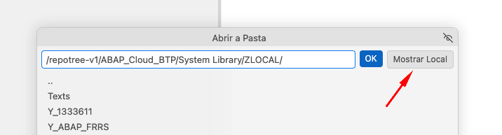

4. Escolha a pasta do projeto que você criou e confirme em **OK**.

5. O Visual Studio Code abre a pasta em uma **nova janela**. É nessa janela que você vai trabalhar no app Fiori nos próximos passos.

</details>

---

## Exercício 5.2: Adicionar o sistema SAP
[^Topo da página](#)

> Na nova janela do Visual Studio Code, adicione o sistema SAP que o Fiori MCP Server vai usar para consumir o serviço OData.

<details>
  <summary>🔵 Clique para expandir!</summary>

1. Na **nova janela** do Visual Studio Code, abra o **Command Palette** com **`Ctrl+Shift+P`** (macOS: **`Cmd+Shift+P`**), digite `>SAP: Add SAP System` e selecione **SAP: Add SAP System**.

   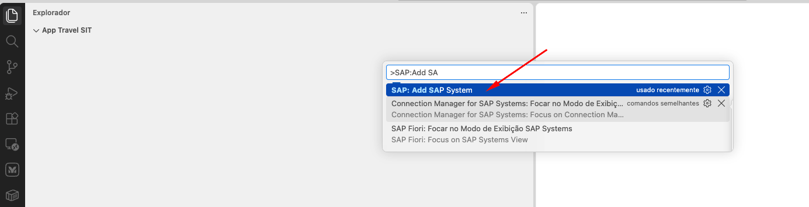

2. A tela **SAP System Details** é exibida, com **System Type** como _ABAP Environment on SAP Business Technology Platform_ e **Connection Type** como _ABAP Catalog_. No campo **Connection Name**, informe um nome para a conexão (por exemplo, `SIT Fortaleza - Hands On`).

3. No campo **URL**, informe o link do seu ambiente **ABAP Trial** do SAP BTP.

   > ℹ️ **Dica**: Esse é o mesmo endereço que você obteve no [Exercício 0.8](../ex0/README.md#exercício-08-conectar-o-visual-studio-code-ao-seu-sistema-abap) (a URL do ambiente, até o `.com`, sem o `/ui#Shell-home`).

   > ⚠️ **Atenção**: o endereço copiado do navegador traz **`-web`** logo depois de `.abap`. Para esta conexão, **remova o `-web`** da URL, deixando apenas `.abap.`. Exemplo fictício:
   >
   > | | URL |
   > |---|---|
   > | Copiada do navegador (não usar) | `https://a1b2c3d4-1234-5678-90ab-cdef12345678.abap-web.us10.hana.ondemand.com` |
   > | A informar no campo **URL** | `https://a1b2c3d4-1234-5678-90ab-cdef12345678.abap.us10.hana.ondemand.com` |

   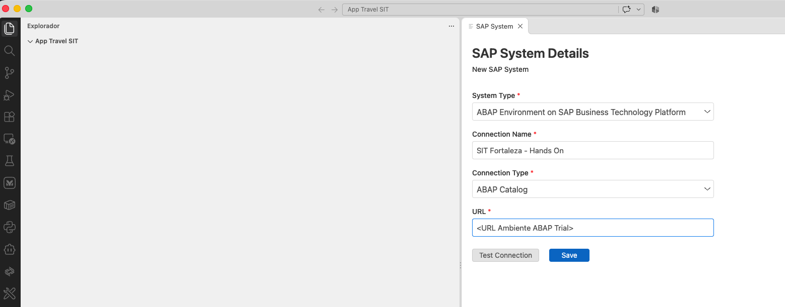

4. Clique em **Test Connection** para validar a conexão com o ambiente.

   > ℹ️ **Nota**: O teste pode demorar um pouco, devido à quantidade de serviços existentes no ambiente. Aguarde o resultado.

   > ✅ Ao final, é exibida a mensagem _The OData V2 catalog call returned N services_, indicando que a conexão foi validada.

   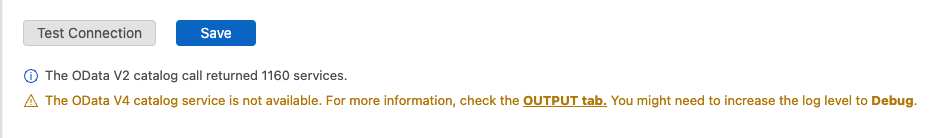

5. Com a conexão validada, clique em **Save** para salvar o sistema.

   > ✅ O sistema passa a aparecer no painel **Connection Manager For SAP Systems**, com o nome da conexão que você informou, por exemplo _SIT Fortaleza - Hands On (ABAP Cloud)_.

   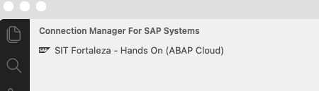

</details>

---

## Exercício 5.3: Testar o Fiori MCP Server
[^Topo da página](#)

> Confirme que o Fiori MCP Server enxerga o sistema SAP que você adicionou no Exercício 5.2.

<details>
  <summary>🔵 Cline - Clique para expandir!</summary>

1. No **Cline**, copie e cole o prompt a seguir:

   ```
   Usando o Fiori MCP Server, liste os sistemas SAP disponíveis. Utilizar a conexão do ambiente SIT Fortaleza - Hands On
   ```

   > ℹ️ Se você usou outro nome em **Connection Name** no Exercício 5.2, use esse nome no prompt.

2. O Cline vai pedir permissão para chamar a tool `list_sap_systems` do **fiori-mcp**. **Permita** a chamada da tool.

   > ✅ O Cline deve listar o sistema **SIT Fortaleza - Hands On**, com a URL do seu ambiente. Isso confirma que o Fiori MCP Server está funcionando e enxerga o seu sistema.

   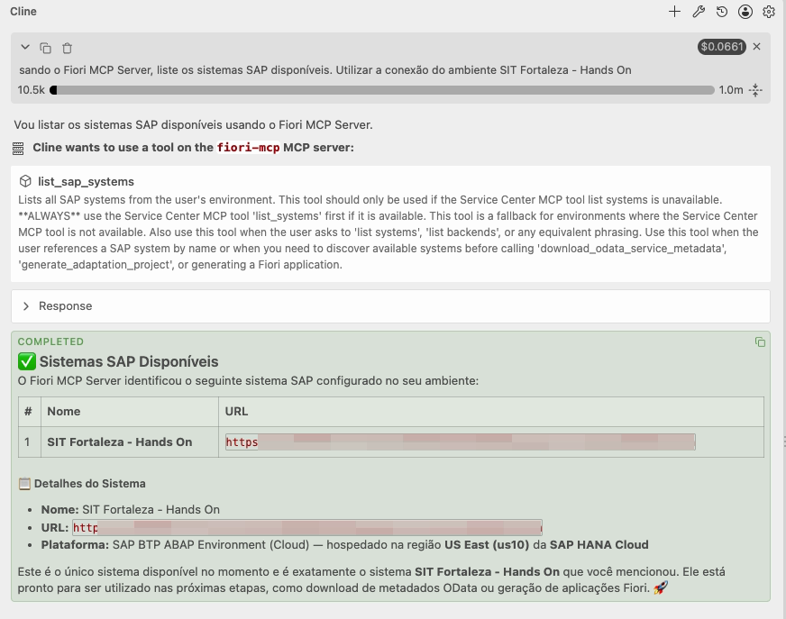

</details>

<details>
  <summary>🔵 Claude Code - Clique para expandir!</summary>

1. No **Claude Code**, copie e cole o prompt a seguir:

   ```
   Usando o Fiori MCP Server, liste os sistemas SAP disponíveis. Utilizar a conexão do ambiente SIT Fortaleza - Hands On
   ```

   > ℹ️ Se você usou outro nome em **Connection Name** no Exercício 5.2, use esse nome no prompt.

2. O Claude Code vai pedir permissão para chamar a tool `list_sap_systems` do **fiori-mcp**. **Permita** a chamada da tool.

   > ✅ O Claude Code deve listar o sistema **SIT Fortaleza - Hands On**, com a URL do seu ambiente.

</details>

---

## Exercício 5.4: Obter o link do serviço OData
[^Topo da página](#)

> Obtenha o link do serviço OData gerado no backend, que será usado na criação do app Fiori.

Execute o prompt abaixo **na janela do projeto ABAP RAP** (a janela onde está o pacote **`ZSITFOR_AI_###`**, e não a janela do projeto Fiori). O link retornado é o que será usado para gerar o app Fiori.

<details>
  <summary>🔵 Cline - Clique para expandir!</summary>

1. No **Cline**, na janela do projeto ABAP RAP, copie e cole o prompt a seguir:

   ```
   Usando o abap-adt, me traga o link do serviço oData que está no pacote ZSITFOR_AI_###
   ```

   > ℹ️ Substitua `###` pelo seu ID do grupo no prompt antes de enviá-lo.

2. O Cline vai consultar o ADT MCP Server e retornar as informações do serviço OData do pacote, entre elas o service binding, o status de publicação, a versão e a URL do serviço.

   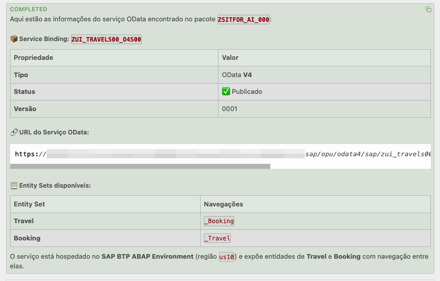

</details>

<details>
  <summary>🔵 Claude Code - Clique para expandir!</summary>

1. No **Claude Code**, na janela do projeto ABAP RAP, copie e cole o prompt a seguir:

   ```
   Usando o abap-adt, me traga o link do serviço oData que está no pacote ZSITFOR_AI_###
   ```

   > ℹ️ Substitua `###` pelo seu ID do grupo no prompt antes de enviá-lo.

</details>

---

## Exercício 5.5: Criar o App Fiori
[^Topo da página](#)

> Use o Fiori MCP Server para gerar o app SAP Fiori elements (List Report + Object Page) sobre o serviço OData do backend.

> ⚠ **Aviso sobre resultados gerados por IA** ⚠
> Esteja ciente de que os resultados gerados por IA na descrição deste exercício podem diferir dos seus. **Sempre revise os artefatos gerados.**

<details>
  <summary>🔵 Cline - Clique para expandir!</summary>

1. Na **janela do projeto Fiori** (a que você abriu no Exercício 5.1), no **Cline** (Act mode), copie e cole o prompt a seguir:

   ```
   Criar um app Fiori no padrão list report + object page para o serviço oData RAP <LINK ODATA RAP>
   ```

   Substitua **`<LINK ODATA RAP>`** pelo link do serviço OData obtido no [Exercício 5.4](#exercício-54-obter-o-link-do-serviço-odata).

   > 💡 **Dica**: você pode melhorar o prompt informando, por exemplo, o **nome do app**, a **descrição** e o **namespace** em que ele será criado. Exemplo:
   >
   > ```
   > Criar um app Fiori no padrão list report + object page para o serviço oData RAP <LINK ODATA RAP>. Nome do app: travel-sit, descrição: Travel Management SIT, namespace: com.sit
   > ```

2. O Cline vai usar as tools do **fiori-mcp** (como `list_sap_systems`, `download_odata_service_metadata` e `generate_fiori_app_odata`) para identificar o seu sistema, baixar o metadata do serviço e gerar o app. Ele também executa o `npm install` ao final. **Permita cada chamada de tool e cada comando** quando solicitado.

   > ℹ️ **Nota**: A geração pode levar alguns minutos, principalmente na instalação das dependências.

3. Ao final, o projeto do app Fiori é criado na pasta do projeto, com as pastas e arquivos do app, como `webapp` e `manifest.json`.

   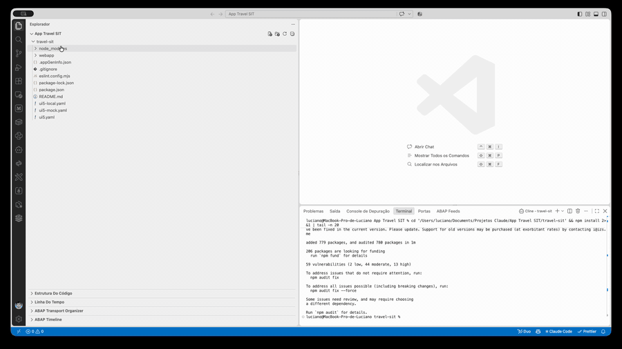

</details>

<details>
  <summary>🔵 Claude Code - Clique para expandir!</summary>

1. Na **janela do projeto Fiori** (a que você abriu no Exercício 5.1), no **Claude Code**, copie e cole o prompt a seguir:

   ```
   Criar um app Fiori no padrão list report + object page para o serviço oData RAP <LINK ODATA RAP>
   ```

   Substitua **`<LINK ODATA RAP>`** pelo link do serviço OData obtido no [Exercício 5.4](#exercício-54-obter-o-link-do-serviço-odata).

   > 💡 **Dica**: você pode melhorar o prompt informando, por exemplo, o **nome do app**, a **descrição** e o **namespace** em que ele será criado. Exemplo:
   >
   > ```
   > Criar um app Fiori no padrão list report + object page para o serviço oData RAP <LINK ODATA RAP>. Nome do app: travel-sit, descrição: Travel Management SIT, namespace: com.sit
   > ```

</details>

---

## Exercício 5.6: Visualizar o App Fiori
[^Topo da página](#)

> Execute o preview do app Fiori a partir do projeto e teste-o no navegador.

<details>
  <summary>🔵 Clique para expandir!</summary>

1. Na **janela do projeto Fiori**, no **Explorer**, clique com o **botão direito** na pasta **`webapp`** e selecione **Preview Application**.

2. Na lista de opções, escolha **start fiori run**.

   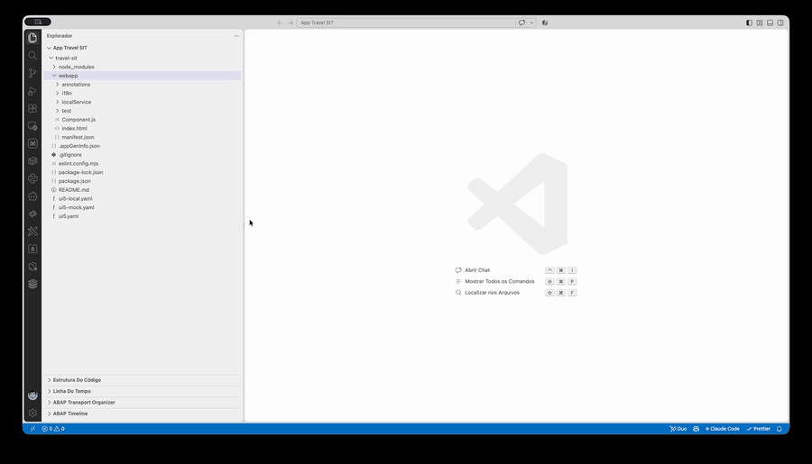

   > ℹ️ **Nota**: O Visual Studio Code abre um terminal e inicia o servidor local do app. Aguarde alguns instantes.

3. Uma **nova janela do navegador** é aberta com o app. Teste o app: use os filtros, clique em **Go** e navegue pelos registros de viagem.

   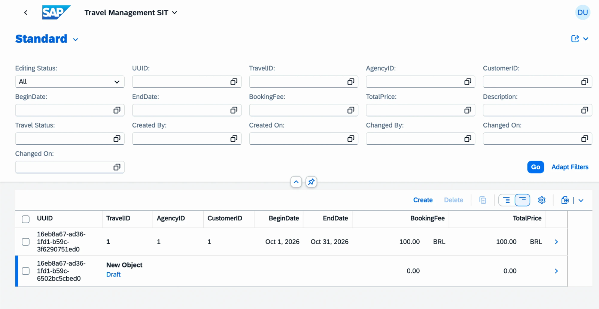

   > ✅ Se a lista de viagens aparecer no navegador, o app foi gerado e está funcionando!

> 💡 **A partir daqui**, você pode customizar toda a parte de **front end** do app usando o Fiori MCP Server, por meio de prompts no seu coding agent.

</details>

---

## Resumo e Próximo Exercício
[^Topo da página](#)

Agora que você:
- Criou a pasta do projeto Fiori
- Abriu a pasta em uma nova janela do Visual Studio Code
- Adicionou o sistema SAP (ABAP Environment on SAP BTP) no Connection Manager for SAP Systems
- Testou o Fiori MCP Server, listando o seu sistema SAP pela tool `list_sap_systems`
- Obteve o link do serviço OData gerado no backend
- Gerou o app SAP Fiori elements (List Report + Object Page) com o Fiori MCP Server
- Executou o preview do app e o testou no navegador

a partir daqui você pode customizar o front end do app usando o Fiori MCP Server.

Você também pode continuar com o exercício opcional: **[Exercício 6: Criar um Custom Agent](../ex06/README.md)**

---
